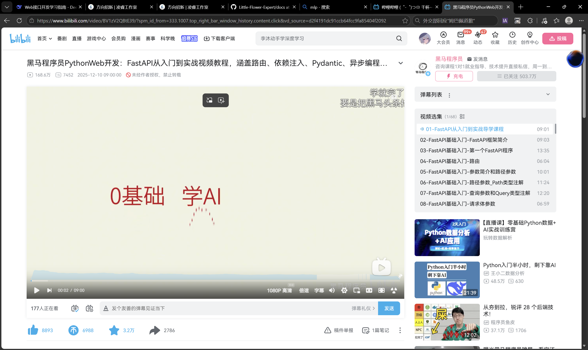
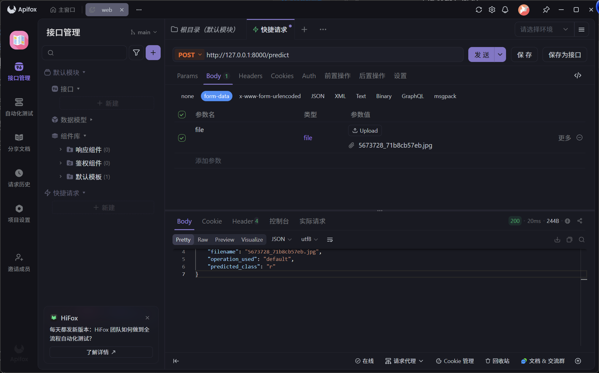

# 交互、部署与接口调用 

## 学习笔记：

- 主要还是用网课来学，学的稀里糊涂，和一起接触的代码风格好不相同，python学的时候连web都还没学，不过大致能厘清一点，，而且好在题目要求的不复杂。
在AI的帮助下差不多写完了。不过仍是花费了不少时间，为了能在主函数上省代码，我尝试在res_pre上作增删，报错了几万次才终于成功，写出了扭曲的代码。

- 在看任务要求的时候本来想选风格迁移模型作为实验模型的，因为它可以接受不同输入（损失权重，学习率等）但因为我写的代码怪异，我自觉得难以改动，所以就换了个简单的识别模型。但是操作只要一种了（键值对）

- （api_first.py）中完成了web的初始化，对模型的初始化，并定义了两个路由，一个预测函数，一个计算器函数。其中核心计算逻辑丢给了其他模块完成。

- 关于model这个文件夹，非常的乱。。。但搞完之后勉强能用。起因是main是主函数，res_net.copy.py导入了它，而res_pre.py又导入了res_net.copy.py，而我是直接复制的源码，所以导入的文件路径还要改一下，中间又是一堆报错。。。

- 不过好在最后还是成功了：

不得不说apifox是真的好用啊！

- 最后也是一样的上传了源码，但是参数太大就没有上传。文件夹可能也有点乱。。。因为写完之后才发现，要改的话太难了，而我已经没时间了，，，，。

- 这是29号的凌晨